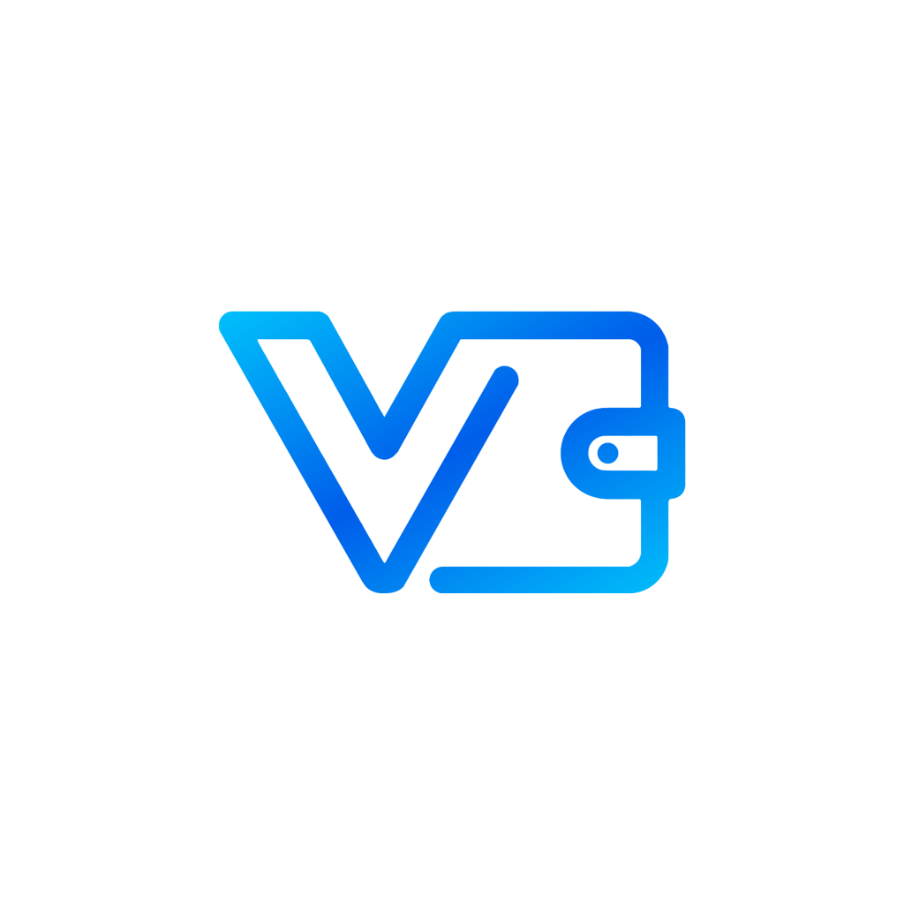
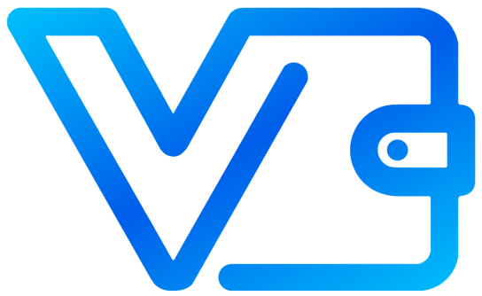

<p align="center">
  
</p>

<h1 align="center">Vaulty — Yeni Nesil Kişisel Finans & Şifreli Kasa Yönetimi</h1>

<p align="center">
  <b>Tüm finansal hayatınızı tek merkezden yönetin. Sıfır bilgi (Zero-Knowledge) mimarisiyle %100 yerel, güvenli ve donanım korumalı.</b>
</p>

<p align="center">
  
  
  
  
  
</p>

---

## 📌 Genel Bakış (Overview)

**Vaulty**, modern bankacılık ve bütçe yönetim deneyimini masaüstünüze getiren, yüksek güvenlik standartlarına sahip yerel bir kişisel finans uygulamasıdır. 

Finansal verileriniz asla harici bulut sunucularına veya üçüncü şahıslara aktarılmaz. Disk üzerindeki tüm kasa verileriniz askeri düzey **AES-256-GCM** ve **Windows DPAPI** (Data Protection API) donanım entropisi ile şifrelenir.

<p align="center">
  
</p>

---

## ✨ Temel Özellikler (Key Features)

### 🛡️ 1. Askeri Düzey Yerel Kasa Güvenliği (AES-256-GCM & DPAPI)
* **At-Rest Şifreleme:** `vault.json` dosyası düz metin yerine 256-bit AES-GCM (Authenticated Encryption) zarfı formatında saklanır.
* **Donanım Bağlantılı Anahtar:** Şifreleme anahtarları doğrudan Windows kullanıcısının yerel DPAPI koruması ve donanım kimliğiyle türetilir.
* **Tarayıcı İçi Güvenlik:** `localStorage` verileri de anlık olarak UTF-8 tabanlı şifreli akışla tutulur.
* **6 Haneli Kasa PIN'i:** Girişte ve hassas işlem onaylarında 6 haneli bankacılık tipi PIN doğrulaması.

### 📊 2. Canlı Finansal Gösterge Paneli (Dashboard)
* **Net Varlık Pozisyonu:** Toplam varlıklar, borçlar ve net servetin anlık hesaplanması.
* **Aylık Nakit Akışı Özeti:** İlgili ayın toplam gelir, harcama ve net tasarruf oranı.
* **Görsel Kart Vitrini:** Banka hesapları ve kredi kartlarının dinamik limit/kullanım barları ve şık gradient kart tasarımları.
* **Son İşlemler & Kategori Dökümü:** En son harcamaların akıllı kategorizasyonu ve ikonografisi.

### 📅 3. Gelişmiş Finansal Nakit Akış Takvimi (Cashflow Calendar)
* **Tüm İşlemler Takvimde:** Sadece planlı ödemeler değil, sisteme girilen tüm standart gelirler, giderler, taksitler, kredi kartı ekstre son ödeme günleri ve borç vadeleri takvim üzerinde görüntülenir.
* **Renk Kodlu Anlık Rozetler:** 
  * 🟢 **Yeşil (+):** Maaş, satış ve tahsilatlar (Gelirler)
  * 🔴 **Kırmızı (−):** Günlük harcamalar, faturalar ve nakit çıkışları
  * 🟣 **Mor:** Kredi ve alışveriş taksitleri
  * 🔵 **Mavi:** Kredi kartı ekstre son ödeme günleri
* **Akıllı Filtreleme:** `Tümü`, `Gelirler`, `Giderler` ve `Planlı & Vadeler` sekmeleriyle takvim hareketlerini tek tıkla filtreleme.
* **Günlük Akış Detayı:** Tıklanan günün tüm detay dökümü ve net nakit pozisyonu.

### 💳 4. Varlık & Hesap / Kart Yönetimi
* **Çoklu Hesap Desteği:** Vadesiz mevduat, vadeli hesap, döviz/altın kasası, yatırım hesabı ve nakit cüzdanlar.
* **Kredi Kartı Takibi:** Güncel borç, kullanılabilir limit, hesap kesim tarihi ve son ödeme günü uyarıları.
* **Hesaplar Arası Transfer:** Komisyonsuz veya masraflı virman ve transfer kayıtları.

### 🤝 5. Borç & Alacak Defteri (Ledger Desk)
* Kişilere veya kurumlara verilen borçlar ve alınan borçların vadesiyle birlikte takibi.
* Kısmi ödeme yapma, tek tıkla borç kapatma ve tahsilat makbuzu düşme.
* Yaklaşan veya geciken alacaklar için akıllı uyarı sistemi.

### 🔄 6. Tekrarlayan İşlemler & Otomasyon Motoru
* Aylık kira, aidat, internet faturası ve dijital abonelikler (Netflix, Spotify vb.) için otomatik yinelenen işlem kuralları.
* Haftalık, aylık veya yıllık frekans desteği.

### 🎯 7. Birikim Hedefleri & Dijital Kumbaralar
* Araba, tatil, acil durum fonu vb. hedefler için ayrı kumbaralar oluşturma.
* Hedefe kalan tutar, tamamlanma yüzdesi ve görsel doluluk animasyonları.

### ⚙️ 8. Modüler Ayarlar Hub'ı
* **Profil Yönetimi:** Kullanıcı adı ve yerel profil avatarı yükleme/değiştirme.
* **Para Birimi & Portföy:** 2 kolonlu şık ızgarada TRY (₺), USD ($), EUR (€) ve Gram Altın (XAU) desteği.
* **Tam Kasa Yedekleme:** Tek tıkla JSON formatında tam şifreli/şifresiz yedek alma ve yedekten anında geri yükleme.
* **Gizlilik Modu:** Tek tuşla veya açılışta tüm tutarları sansürleyen (••••) gizlilik kalkanı.

---

## 🏗️ Teknoloji Yığını & Mimari (Tech Stack)

```
┌────────────────────────────────────────────────────────┐
│                   Vaulty Masaüstü                       │
├────────────────────────────────────────────────────────┤
│  Çekirdek: C# .NET 9.0 (WinExe, Native Single-File)   │
│  UI Motoru: Microsoft.Web.WebView2 (Chromium Evergreen)│
│  Şifreleme: System.Security.Cryptography.AesGcm + DPAPI│
├────────────────────────────────────────────────────────┤
│                   Web Katmanı (Frontend)               │
├────────────────────────────────────────────────────────┤
│  Mimari: Modüler Vanilla JavaScript (ES6+ / BEM CSS)   │
│  Depolama: Şifreli LocalStorage + C# Native File Bridge│
│  Bileşenler: cards/, charts/, recurring/, tables/      │
│  Görünümler: overview, transactions, debts, calendar   │
└────────────────────────────────────────────────────────┘
```

---

## 📁 Proje Dosya Yapısı (Project Structure)

```text
vaulty-pc/
├── assets/                  # Uygulama ikonları, logolar ve medya dosyaları
│   ├── app-icon.ico
│   ├── vault-logo.png
│   └── vault-logo-full.png
├── components/              # Yeniden kullanılabilir UI bileşenleri
│   ├── cards/               # Kart ve varlık bileşenleri & stilleri
│   ├── charts/              # Finansal grafik motoru
│   ├── recurring/           # Tekrarlayan işlem hesaplama motoru
│   ├── sidebar/             # Navigasyon kenar çubuğu
│   └── tables/              # Dinamik işlem tabloları
├── core/                    # Çekirdek mimari
│   ├── events.js            # Olay dinleme & pub-sub mimarisi
│   ├── state.js             # Reaktif durum (State) yöneticisi
│   └── storage.js           # Şifreli depolama sürücüsü
├── modals/                  # Modüler işlem pencereleri
│   ├── account-modals.js    # Ayarlar, profil ve hesap yönetimi
│   ├── new-transaction.js   # Yeni gelir/gider ekleme modalı
│   ├── debt-pay-desk.js     # Borç ödeme masası
│   └── modals.css           # Modal pencereleri stilleri
├── src-desktop/             # .NET 9 Masaüstü Barındırıcı (Host)
│   ├── Program.cs           # WebView2 ayağa kaldırma & AES-256 şifreleme
│   └── Vaulty.csproj        # Tekil exe derleme ve gömülü kaynak kuralları
├── views/                   # Ana uygulama ekranları
│   ├── overview.js          # Genel bakış paneli
│   ├── transactions.js      # İşlem hareket dökümü
│   ├── debts.js             # Borç & alacak takip ekranı
│   ├── assets.js            # Varlıklar ve kartlar ekranı
│   ├── calendar.js          # Finansal nakit akış takvimi
│   └── views.css            # Ekranlara özel ortak stiller
├── dashboard.html           # Ana uygulama paneli
├── index.html               # Güvenli kilit & oturum açma ekranı
├── CHANGELOG.md             # Detaylı sürüm geçmişi
└── Vaulty.exe               # Derlenmiş, taşınabilir tekil çalıştırılabilir dosya
```

---

## 🚀 Kurulum & Çalıştırma (Getting Started)

### Seçenek 1: Doğrudan Çalıştırma (Hazır Exe)
Herhangi bir kuruluma ihtiyaç duymadan, projenin kök dizinindeki `Vaulty.exe` dosyasını çift tıklayarak anında çalıştırabilirsiniz.
* **Varsayılan PIN:** `000000` (Giriş yaptıktan sonra sol alttaki profil sekmesinden kendi 6 haneli PIN kodunuzu belirleyebilirsiniz).

### Seçenek 2: Kaynak Koddan Derleme (Build from Source)

#### Gereksinimler:
* Windows 10 / 11 (64-bit)
* [.NET 9.0 SDK](https://dotnet.microsoft.com/download/dotnet/9.0)
* [Microsoft Edge WebView2 Runtime](https://developer.microsoft.com/en-us/microsoft-edge/webview2/) (Windows 10/11'de varsayılan olarak yüklüdür)

#### Derleme Adımları:

1. Repoyu klonlayın:
```bash
git clone https://github.com/anilhacioglu/vaulty.git
cd vaulty
```

2. Bağımlılıkları geri yükleyin ve tekil exe olarak derleyin:
```bash
dotnet publish src-desktop/Vaulty.csproj -c Release -r win-x64 --self-contained false -p:PublishSingleFile=true -o dist
```

3. Çıktıyı çalıştırın:
```bash
./dist/Vaulty.exe
```

---

## 🔒 Güvenlik & Gizlilik İlkeleri (Security & Privacy)

1. **Sıfır Bulut Bağımlılığı (Offline-First):** Vaulty internet bağlantısı olmadan %100 çevrimdışı çalışacak şekilde tasarlanmıştır. Verileriniz bilgisayarınızın dışına çıkmaz.
2. **AES-256-GCM Bütünlük Kontrolü:** Kasa dosyanız kaydedilirken 12-byte rastgele IV (nonce) ve 16-byte doğrulama etiketi (auth tag) üretilir. Verilerde harici bir oynama veya bozulma olursa sistem bunu tespit eder.
3. **Bellek İçi Çözme:** Veriler yalnızca uygulama açıkken ve kilit açıldığında RAM üzerinde şifresi çözülmüş halde tutulur; oturum kapatıldığında veya uygulama sonlandığında bellek temizlenir.

---

## 📝 Değişiklik Günlüğü (Changelog)

En son sürüm notları, yeni eklenen özellikler ve hata düzeltmeleri için [CHANGELOG.md](CHANGELOG.md) dosyasına göz atabilirsiniz.

* **v1.6.0** — Yenilenen Açık/Koyu tema (`theme.css`), akıcı mikro animasyonlar (`motion.js`), 3 farklı kart kaplamasına sahip interaktif 3D cüzdan vitrini, kaydırmasız tek ekran deneyimine geçirilen İşlemler / Borç & Alacak / Varlıklarım / Nakit Akışı Takvimi ekranları, sadeleştirilmiş sol menü ve giriş ekranı PIN maskeleme düzeltmesi.
* **v1.5.1** — AES-256-GCM tam disk şifrelemesi, tüm işlemleri gösteren Nakit Akış Takvimi, 6 haneli PIN güvenlik denetleyicisi, çoklu para birimi grid düzenlemesi ve UI kontrast düzeltmeleri.
* **v1.5.0** — Modüler CSS/JS mimarisi tamamlandı, tekil `Vaulty.exe` uygulaması olarak birleştirildi.

---

## 📄 Lisans (License)

Bu proje [MIT Lisansı](LICENSE) kapsamında lisanslanmıştır. Detaylar için `LICENSE` dosyasına bakabilirsiniz.

